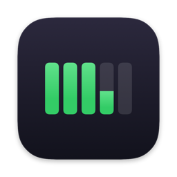
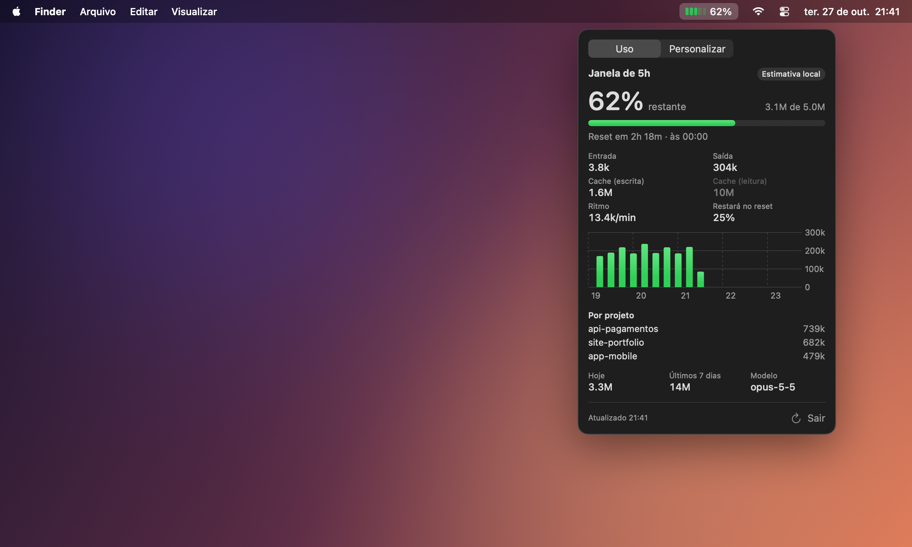
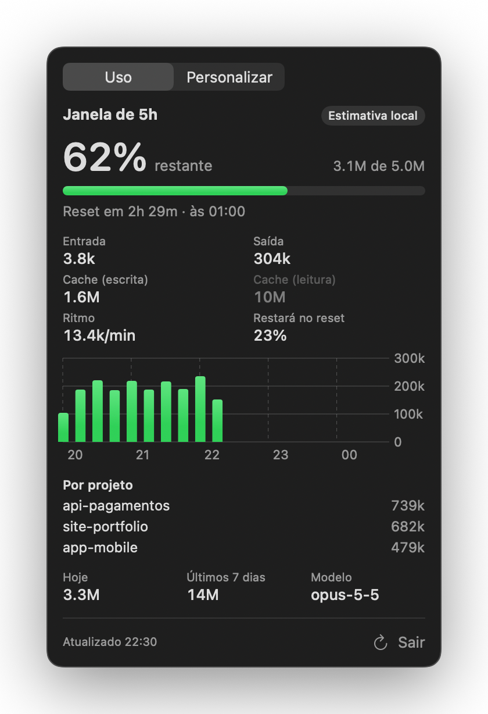
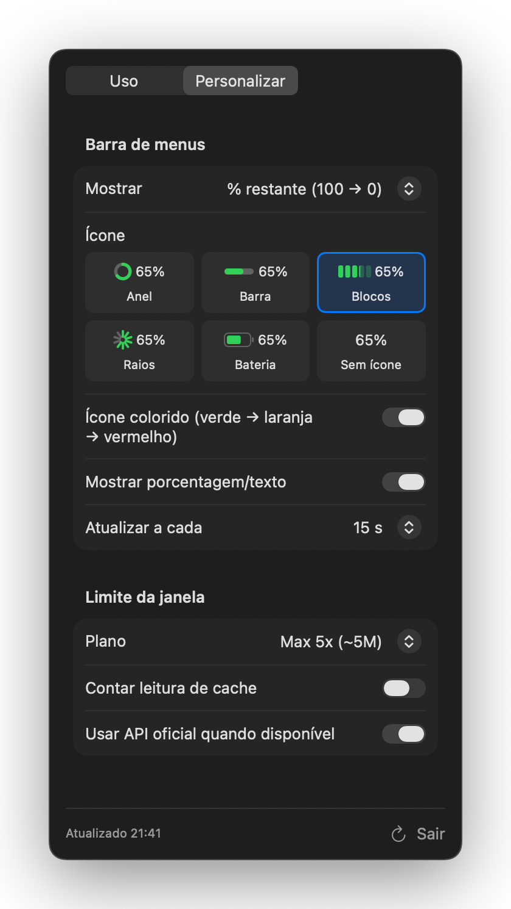
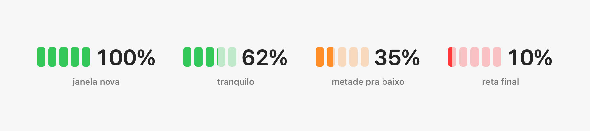

<p align="center"></p>

# Claude Usage

**Sua janela de 5h do Claude, ao vivo na barra de menus do Mac — de 100% até 0%.**



Um app leve de barra de menus para macOS que mostra quanto ainda resta da sua janela de uso de 5 horas do Claude Code. O ícone vai esvaziando e mudando de cor conforme você usa; um clique abre os detalhes.

> Projeto pessoal e independente, sem vínculo com a Anthropic.

---

## Sumário

- [Recursos](#recursos)
- [Instalação](#instalação)
- [Primeiro uso](#primeiro-uso)
- [Lendo o ícone](#lendo-o-ícone)
- [O painel](#o-painel)
- [Como funciona](#como-funciona)
- [Abre junto com o Claude Code](#abre-junto-com-o-claude-code)
- [Privacidade](#privacidade)
- [Limitações](#limitações)
- [Solução de problemas](#solução-de-problemas)
- [Desinstalar](#desinstalar)
- [Desenvolvimento](#desenvolvimento)
- [Licença](#licença)

## Recursos

- **Ao vivo na barra de menus:** % restante da janela de 5h, atualizada a cada poucos segundos.
- **Cores por nível:** verde → laranja (metade pra baixo) → vermelho (reta final).
- **Detalhes a um clique:** tempo até o reset, tokens por tipo, ritmo de uso, quanto vai sobrar no reset, gráfico da janela, consumo por projeto, hoje e últimos 7 dias.
- **Personalizável:** 6 estilos de ícone, % restante ou usada, tokens ou tempo até o reset, limite do plano, cores e intervalo de atualização.
- **Abre junto com o Claude Code** (opcional) e/ou ao iniciar o Mac.
- **Notificação** quando entra no vermelho.
- **Leve e local:** um app nativo em Swift de ~1 MB que só lê arquivos do seu Mac.

| Uso | Personalizar |
| --- | --- |
|  |  |

## Instalação

**Requisitos:** macOS 14 (Sonoma) ou mais novo · Mac Intel ou Apple Silicon · [Claude Code](https://docs.claude.com/en/docs/claude-code/overview) instalado (terminal, app desktop ou extensão de IDE).

### Opção 1 — Baixar pronto

1. Baixe o `ClaudeUsage.zip` na página de [Releases](../../releases/latest).
2. Descompacte e arraste o **ClaudeUsage.app** para a pasta **Aplicativos**.
3. Abra o app. Como ele não é assinado com um certificado da Apple, o macOS vai bloquear na primeira vez:
   - Vá em **Ajustes do Sistema → Privacidade e Segurança**, role até o aviso sobre o ClaudeUsage e clique em **Abrir Mesmo Assim**; ou
   - rode no Terminal:

     ```bash
     xattr -dr com.apple.quarantine /Applications/ClaudeUsage.app
     ```

### Opção 2 — Compilar a partir do código

Requer o Xcode ou só as Command Line Tools (`xcode-select --install`). Com o Xcode o app sai universal (Intel + Apple Silicon); só com as Command Line Tools, sai para a arquitetura do seu Mac.

```bash
git clone https://github.com/Lucas-Lutti/claude-usage.git
cd claude-usage
./build.sh --install   # compila e copia para /Applications
open /Applications/ClaudeUsage.app
```

`./build.sh` sozinho só gera `build/ClaudeUsage.app`; `--zip` também gera o zip de release.

## Primeiro uso

Ao abrir pela primeira vez:

1. O ícone aparece na barra de menus (o app não tem janela nem ícone no Dock).
2. O app adiciona um hook ao Claude Code para abrir junto com ele — veja [abaixo](#abre-junto-com-o-claude-code).
3. Clique no ícone → **Personalizar → Plano** e escolha o seu plano, ou ajuste o limite (veja [Como funciona](#o-limite-é-uma-estimativa)).
4. Opcional: ligue **Abrir ao iniciar sessão** para ele subir com o Mac.

## Lendo o ícone



| Cor | Quando | Padrão |
| --- | --- | --- |
| 🟩 Verde | Mais da metade restante | acima de 50% |
| 🟧 Laranja | Metade pra baixo | 50% a 15% |
| 🟥 Vermelho | Reta final (e notificação) | abaixo de 15% |

Os limites das cores são ajustáveis em **Personalizar → Alertas**.
Sem janela ativa (você não usou o Claude nas últimas 5h), o ícone fica cheio em 100%.

## O painel

### Aba Uso

| Item | O que é |
| --- | --- |
| **% restante** | Quanto sobra da janela atual em relação ao limite. Mostra "usado" se você escolher o modo crescente. |
| **X de Y** | Tokens restantes / limite da janela. |
| **Reset em** | Tempo até a janela fechar e o horário exato. |
| **Entrada / Saída** | Tokens enviados e gerados. |
| **Cache (escrita / leitura)** | Tokens gravados e lidos do cache de prompt. A leitura aparece apagada quando não entra na conta. |
| **Ritmo** | Média de tokens por minuto desde a primeira mensagem da janela. |
| **Restará no reset** | Projeção de quanto vai sobrar se você mantiver o ritmo atual. |
| **Gráfico** | Consumo em fatias de 15 minutos dentro da janela. |
| **Por projeto** | Consumo por pasta de trabalho na janela atual. |
| **Hoje / Últimos 7 dias / Modelo** | Totais e o modelo mais usado na janela. |
| **Estimativa local / API oficial** | De onde vem a %. Veja [Como funciona](#como-funciona). |

### Aba Personalizar

| Opção | O que faz |
| --- | --- |
| **Mostrar** | Texto da barra: % restante (100 → 0), % usado, tokens usados ou tempo até o reset. |
| **Ícone** | Anel, Barra, Blocos, Raios, Bateria ou só o texto. |
| **Ícone colorido** | Verde/laranja/vermelho. Desligado, o ícone fica monocromático (e só ganha cor no aviso). |
| **Mostrar porcentagem/texto** | Esconde o texto e deixa só o ícone. |
| **Atualizar a cada** | 5 s, 15 s, 30 s ou 1 min. |
| **Plano** | Define o limite da janela (100%). Veja abaixo. |
| **Contar leitura de cache** | Inclui os tokens lidos do cache na conta. Desligado por padrão. |
| **Usar API oficial quando disponível** | Usa a % oficial se houver login do Claude Code no terminal. |
| **Laranja / Vermelho abaixo de** | Limites das cores. |
| **Notificar quando ficar vermelho** | Uma notificação por janela. |
| **Abrir ao iniciar sessão** | Abre com o Mac. |
| **Abrir junto com o Claude Code** | Liga/desliga o hook. |

## Como funciona

### De onde vêm os dados

O Claude Code grava cada conversa em arquivos `.jsonl` em `~/.claude/projects/` (ou nas pastas de `CLAUDE_CONFIG_DIR`). Cada resposta do Claude traz quantos tokens usou. O app lê esses arquivos de forma incremental — só os bytes novos a cada atualização — e ignora respostas duplicadas do streaming.

Isso cobre tudo que passa pelo Claude Code: terminal, aba Code do app desktop e extensões de IDE.

### A janela de 5h

Uma janela começa na hora cheia da sua primeira mensagem e dura 5 horas (ex.: primeira mensagem às 14:37 → janela das 14:00 às 19:00). Depois que ela fecha, a próxima mensagem abre uma nova.

### O limite é uma estimativa

A Anthropic não publica os limites de cada plano em tokens, então a % local é **relativa a um limite que você escolhe**:

| Plano | Limite usado |
| --- | --- |
| Pro | ~1M tokens |
| Max 5x | ~5M tokens (padrão) |
| Max 20x | ~20M tokens |
| Automático | A maior janela que você já usou nos últimos 8 dias |
| Personalizado | O número que você digitar |

Por padrão contam entrada + saída + escrita em cache. Se a % não bater com a sua experiência (por exemplo, você bate no limite com o app ainda mostrando 40%), ajuste em **Personalizado**. Uma forma prática de calibrar: quando você bater no limite de verdade, veja o total de tokens da janela no painel e use esse valor.

### API oficial (opcional)

Se você estiver logado no **Claude Code pelo terminal** (comando `claude`), o login fica no Keychain do macOS. Nesse caso o app consulta o mesmo endpoint usado pelo comando `/usage` e mostra a **% oficial** da janela de 5h e do limite semanal, com o selo "API oficial". O macOS pode pedir permissão para o app ler esse item do Keychain.

Sem esse login (por exemplo, se você só usa o app desktop), o app usa a estimativa local.

## Abre junto com o Claude Code

Na primeira execução, se encontrar a pasta `~/.claude`, o app adiciona este hook em `~/.claude/settings.json`:

```json
{
  "hooks": {
    "SessionStart": [
      {
        "hooks": [
          { "type": "command", "command": "open -g -b local.claudeusage >/dev/null 2>&1 || true", "timeout": 10 }
        ]
      }
    ]
  }
}
```

Toda sessão nova do Claude Code abre o app em segundo plano; se ele já estiver aberto, nada acontece. O comando nunca falha e não envia nada para a conversa.

- Desligue em **Personalizar → Abrir junto com o Claude Code** — o hook é removido.
- Seus outros hooks e configurações são preservados.
- Antes da primeira alteração, o arquivo original é copiado para `~/.claude/settings.json.claudeusage-backup`.
- Se o `settings.json` existente tiver um erro de JSON, o app não mexe nele.
- Se você desligar, o app não recria o hook sozinho.

## Privacidade

- O app **só lê** arquivos locais do Claude Code e grava apenas o hook descrito acima.
- Nenhum dado é enviado para lugar nenhum, exceto a consulta opcional à API da Anthropic (`api.anthropic.com`) quando há login do Claude Code no terminal — a mesma que o próprio Claude Code faz.
- Sem analytics, sem telemetria, sem conta.

## Limitações

- **É uma estimativa** quando não há API oficial: o limite real depende do plano, do modelo e da política da Anthropic.
- **Conversas no claude.ai** (navegador ou chat do app desktop) não ficam salvas no Mac e não entram na conta — só o que passa pelo Claude Code.
- **Outros computadores:** o uso feito em outra máquina com a mesma conta não aparece.
- **Assinatura:** o app não é notarizado pela Apple, por isso o aviso na primeira abertura.

## Solução de problemas

**O ícone não aparece.**
Em MacBooks com notch, ícones podem ficar escondidos atrás dele quando a barra está cheia. Feche alguns ícones ou segure ⌘ e arraste o ícone para mais perto do relógio. Confira também se o app está rodando: `pgrep -l ClaudeUsage`.

**Mostra 100% mesmo eu tendo usado o Claude.**
Confira se há dados: rode `/Applications/ClaudeUsage.app/Contents/MacOS/ClaudeUsage --dump`. Se aparecer "nenhuma janela ativa", o Claude Code não foi usado nas últimas 5h ou grava os arquivos em outro lugar (`CLAUDE_CONFIG_DIR`).

**A % não bate com o limite real.**
Veja [O limite é uma estimativa](#o-limite-é-uma-estimativa) e ajuste o plano ou o limite personalizado.

**Não abre junto com o Claude Code.**
Confira se a opção está ligada em Personalizar e se o hook está em `~/.claude/settings.json`. Sessões que já estavam abertas não disparam o hook — abra uma nova.

**"O app não pode ser aberto porque é de um desenvolvedor não identificado."**
Veja o passo 3 da [instalação](#opção-1--baixar-pronto).

## Desinstalar

1. No painel, desligue **Abrir junto com o Claude Code** e **Abrir ao iniciar sessão**.
2. Clique em **Sair**.
3. Apague o app e as preferências:

   ```bash
   rm -rf /Applications/ClaudeUsage.app
   defaults delete local.claudeusage
   ```

Se você apagou o app sem desligar o hook, remova o bloco do `ClaudeUsage` em `hooks.SessionStart` no `~/.claude/settings.json` (ou restaure `~/.claude/settings.json.claudeusage-backup`).

## Desenvolvimento

```
Sources/ClaudeUsage/
├── main.swift                 # AppDelegate, item da barra de menus, modo --dump
├── TranscriptScanner.swift    # leitura incremental dos .jsonl
├── Models.swift               # tokens, janelas de 5h, formatação
├── UsageStore.swift           # estado, cálculos (%, ritmo, projeção), notificações
├── OfficialUsageClient.swift  # % oficial via login OAuth do Claude Code
├── ClaudeHook.swift           # instala/remove o hook SessionStart
├── StatusIcon.swift           # desenho dos ícones
├── PopoverView.swift          # painel (SwiftUI)
└── Settings.swift             # preferências
Resources/AppIcon.icns         # ícone do app
marketing/                     # geradores das imagens de docs/images e do ícone
```

```bash
swift build                                                    # compila para desenvolvimento
./build.sh                                                     # gera o .app universal
build/ClaudeUsage.app/Contents/MacOS/ClaudeUsage --dump        # imprime a janela atual no terminal
./marketing/render.sh                                          # regenera as imagens com dados de demonstração
./marketing/icon.sh [escuro|cores|quente]                      # regenera o ícone do app (Resources/AppIcon.icns)
```

Contribuições são bem-vindas — abra uma issue ou um pull request.

## Licença

[MIT](LICENSE) © Lucas Picinin

"Claude" é uma marca da Anthropic. Este projeto não é afiliado, endossado ou patrocinado pela Anthropic.
